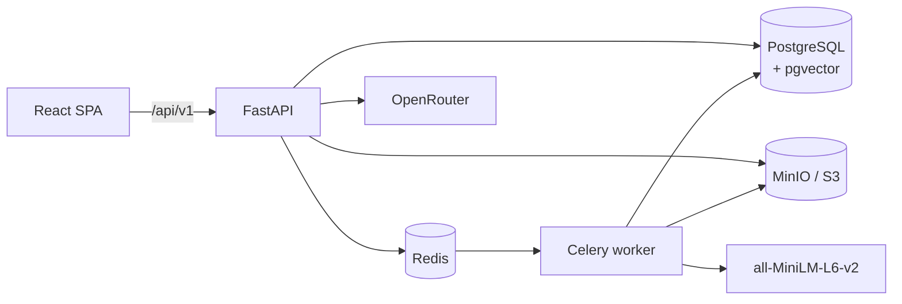

# Docuflow

**A multi-tenant legal document workspace with organization-scoped AI search.**

Docuflow combines versioned document management, folder trees, comments, an audit
trail, role-based access control and invitations with a retrieval-augmented
generation (RAG) assistant that answers from a tenant's own files.

[](https://github.com/MuhammadHaider1/docuflow/actions/workflows/ci.yml)
[](https://www.python.org/)
[](https://fastapi.tiangolo.com/)
[](https://react.dev/)
[](https://www.typescriptlang.org/)
[](./LICENSE)

---

## Highlights

- **Multi-tenant by design** — every document, chunk, folder, comment, audit event
  and invitation is scoped to an organization.
- **RBAC with 8 seeded roles and 11 permissions** — deny-by-default API checks and a
  permission-aware UI, including a separate Member role for invitees.
- **Document pipeline** — PDF, DOCX, TXT and image uploads are stored in MinIO,
  extracted, chunked and embedded into PostgreSQL with pgvector.
- **Grounded Ask AI** — answers are generated from the requesting organization's
  retrieved chunks and streamed token by token. If the context does not contain the
  answer, the assistant says so instead of inventing one.
- **Multiple-choice inference** — quiz files often contain questions and options but
  no answer key. Those questions are answered with the best option and labelled
  `(inferred; the source does not mark an answer)`; every other question stays
  strictly grounded.
- **Retrieval diversity** — vector search fetches a wider candidate set, limits how
  many chunks one document can contribute, deduplicates repeated uploads and
  backfills, so a long CV cannot crowd out the quiz or contract being asked about.
- **Invitations and membership** — invite links are bound to the inviting
  organization and always join as `Member`; no cross-tenant escalation.
- **Operational visibility** — audit log, notifications, health endpoint, rate
  limiting and structured document status transitions (`pending → processing →
  completed | failed`).

---

## Architecture



The API and Celery worker share the same codebase. Documents are uploaded through
the API, processed asynchronously by the worker, and retrieved synchronously during
Ask AI requests.

---

## Repository layout

```text
docuflow/
├── .github/workflows/ci.yml     # backend lint/tests, frontend lint/tests/build, secret scan
├── backend/                    # FastAPI + SQLAlchemy + Celery + pgvector
│   ├── docker/                 # API and worker Dockerfiles
│   ├── docker-compose.yml      # PostgreSQL/pgvector, Redis, MinIO
│   ├── migrations/             # legacy Alembic revisions (see note below)
│   ├── scripts/                # manual RAG utilities
│   ├── src/                    # API, models, repositories, services, tasks
│   ├── tests/                  # pytest suite (108 tests, mocked DB session)
│   └── README.md               # backend deep dive
├── frontend/                   # React 18 + Vite + TypeScript SPA
│   ├── src/                    # features, components, API client, stores
│   ├── public/
│   └── README.md               # frontend deep dive, UX and deployment notes
├── .gitignore
├── LICENSE
└── README.md
```

---

## Tech stack

| Layer | Technology |
| --- | --- |
| API | FastAPI, Pydantic v2, SQLAlchemy 2 async |
| Database | PostgreSQL 16 + pgvector (`vector(384)`) |
| Async jobs | Celery + Redis |
| Object storage | MinIO (S3 compatible) |
| RAG | sentence-transformers (`all-MiniLM-L6-v2`), OpenRouter |
| Auth | JWT access/refresh rotation, Argon2 password hashing |
| Frontend | React 18, Vite, TypeScript strict, Tailwind CSS |
| UI | shadcn-style Radix primitives, lucide-react, Fraunces + Inter |
| Client state | TanStack Query v5, Zustand |
| Forms | react-hook-form + zod |
| Tests | pytest, Vitest, React Testing Library |
| Lint/format | ruff (backend), ESLint + Prettier (frontend) |

---

## Quick start

### Prerequisites

- Python **3.12+**
- Node.js **20+** and npm
- Docker + Docker Compose
- An [OpenRouter API key](https://openrouter.ai/keys) if you want generated
  answers (the API still runs without one and returns retrieved excerpts)

### 1. Clone

```bash
git clone https://github.com/MuhammadHaider1/docuflow.git
cd docuflow
```

### 2. Backend

```bash
cd backend

python -m venv .venv
source .venv/bin/activate          # Windows: .venv\Scripts\activate
pip install -r requirements.txt -r requirements-dev.txt

cp .env.example .env
# Edit .env: set SECRET_KEY and OPENROUTER_API_KEY.
# Generate a signing key with: openssl rand -hex 32

docker compose up -d               # PostgreSQL/pgvector, Redis, MinIO
python init_db.py                  # create tables and seed RBAC

uvicorn src.main:app --reload --port 8000
```

In a second shell, start the document worker:

```bash
cd backend
source .venv/bin/activate
celery -A src.tasks.celery_app.app worker --loglevel=info
```

API docs: <http://localhost:8000/docs>

> **Database note.** `init_db.py` is the supported schema path. The stored Alembic
> revisions are legacy snapshots and do not reproduce the current schema from an
> empty database.

### 3. Frontend

```bash
cd frontend
cp .env.example .env.local         # optional: local defaults already work
npm install
npm run dev                        # http://localhost:5180
```

The Vite dev server proxies `/api/*` to `http://localhost:8000`, so no CORS
configuration is needed locally. Override the proxy with `VITE_DEV_API_PROXY`.

### 4. Create your first workspace

1. Register at `/register` (the API rejects some reserved TLDs such as `.test`).
2. Create an organization at `/app/onboarding` — the creator becomes
   **Organization Owner**.
3. Upload a PDF, DOCX, TXT or image and wait for the status to reach **Indexed**.
4. Open **Ask AI** and ask a question about the uploaded file.

For a fully local embedding model, install the optional RAG dependencies and place
the model at `EMBEDDING_MODEL_PATH` (default `backend/models/all-MiniLM-L6-v2`):

```bash
cd backend
pip install -r requirements-rag.txt
```

---

## Configuration

Copy the example files and fill in your own values. **Never commit real secrets.**

| Variable | Purpose |
| --- | --- |
| `SECRET_KEY` | JWT signing key (`openssl rand -hex 32`) |
| `DB_USER`, `DB_PASSWORD`, `DB_HOST`, `DB_PORT`, `DB_NAME` | PostgreSQL connection |
| `MINIO_ENDPOINT`, `MINIO_ACCESS_KEY`, `MINIO_SECRET_KEY`, `MINIO_BUCKET_NAME` | Object storage |
| `OPENROUTER_API_KEY` | Enables RAG answer generation |
| `OPENROUTER_MODEL` | Model id; defaults to `nvidia/nemotron-3-nano-omni-30b-a3b-reasoning:free` |
| `OPENROUTER_FALLBACK_MODEL` | Optional server-side fallback model |
| `FRONTEND_URL` | Builds invitation links |
| `EMBEDDING_MODEL_PATH`, `EMBEDDING_MODEL_ID` | Local or Hugging Face embedding model |
| `VITE_API_BASE_URL` | Frontend API base (default `/api/v1`) |
| `VITE_DEV_API_PROXY` | Dev-only Vite proxy target (default `http://localhost:8000`) |

See [`backend/.env.example`](./backend/.env.example) and
[`frontend/.env.example`](./frontend/.env.example) for the complete lists.

---

## Ask AI / RAG behaviour

1. The question is embedded with `all-MiniLM-L6-v2` (384 dimensions).
2. pgvector returns the nearest chunks **scoped to the active organization**.
3. Retrieval keeps a wider candidate set, caps chunks per document and removes
   duplicates from repeated uploads before building the prompt.
4. OpenRouter generates an answer from those excerpts only. Both
   `POST /api/v1/query` and `POST /api/v1/query-stream` are supported; the SPA uses
   the streaming endpoint.
5. If the context contains a complete multiple-choice item but no answer key, the
   model recalls the fact first, chooses the best option and labels it as inferred.
   Reasoning is enabled only for that case; all other answers remain grounded.
6. If the answer is genuinely absent, the response says the documents do not
   contain it.

The OpenRouter key is read from the backend environment and is never logged,
returned to the browser or committed.

---

## API overview

All routes are prefixed with `/api/v1`. Requests use
`Authorization: Bearer <token>`; tenant-scoped routes also require
`X-Organization-Id: <uuid>`.

| Area | Endpoints |
| --- | --- |
| Auth | `POST /auth/register`, `/auth/login`, `/auth/refresh` |
| Organizations | list, create, get, update, delete |
| Documents & folders | CRUD, folder tree, versions, download |
| RBAC & members | roles, permissions, member directory, role assignment, invitations |
| RAG | `POST /query`, `POST /query-stream` |
| Comments | CRUD |
| Audit | `GET /audit` |
| Notifications | list, read/unread, bulk mark-read |

```bash
curl -X POST http://localhost:8000/api/v1/query \
  -H "Authorization: Bearer $TOKEN" \
  -H "X-Organization-Id: $ORG_ID" \
  -H "Content-Type: application/json" \
  -d '{"query": "How much written notice is required to terminate the agreement?"}'
```

---

## Quality gates

```bash
# Backend — no PostgreSQL/Redis/MinIO required (mocked async session)
cd backend
pytest -q
ruff check src tests
ruff format --check src tests

# Frontend
cd frontend
npm run lint
npm run test
npm run build
```

GitHub Actions runs the same checks on every push and pull request to `main`, plus
a secret scan that fails on committed `.env` files, API keys, Hugging Face tokens
and private keys.

---

## Deployment

- `backend/docker/fastapi.Dockerfile` and `celery.Dockerfile` build the API and
  worker.
- `frontend/Dockerfile` + `frontend/nginx.conf` build and serve the SPA.
- `backend/docker-compose.yml` provides PostgreSQL/pgvector, Redis and MinIO.
- Bind the API to loopback and put a TLS reverse proxy (nginx, Caddy, Tailscale
  Funnel or a cloud load balancer) in front of it. Keep the database, Redis, MinIO
  and the API port private.
- Set `FRONTEND_URL` to the public web origin so invitation links resolve.
- Every route is rate limited; login and registration are capped at 5/minute.

---

## Security

- `.env` files are git-ignored and CI fails if one is ever committed.
- Passwords use Argon2 with a 12-character minimum and a common-password denylist.
- Access tokens stay in memory; refresh tokens use `sessionStorage` and rotate.
- Authorization is deny-by-default and checked on the server, not just in the UI.
- The OpenRouter API key is never echoed to clients or written to logs.
- Uploads are stored in MinIO and served through authenticated API routes.

---

## Known limitations

- Stored Alembic revisions are legacy; use `init_db.py` (or `create_all` on startup).
- Email delivery is not configured by default — invitations expose copy/mailto links
  until SMTP is wired up.
- Archived document listing is reconstructed from audit events; there is no
  `include_archived` filter yet.
- OCR is not implemented for scanned PDFs and images; extraction relies on text
  layers (`pypdf`, `python-docx`).
- The default OpenRouter model is a free tier and can be rate-limited upstream.

---

## License

MIT — see [LICENSE](./LICENSE).
